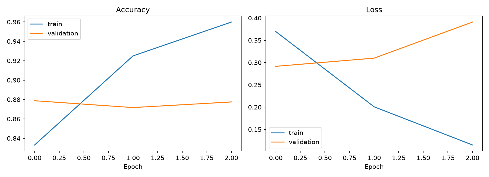
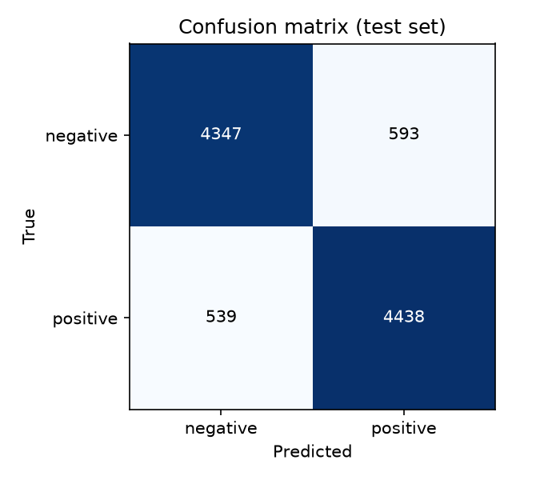

# IMDB Movie Review Sentiment Analysis (Bidirectional LSTM)

A deep learning model that reads a movie review and classifies it as **positive** or **negative**.
Built with TensorFlow/Keras on the IMDB 50K reviews dataset.

## Dataset
"IMDB Dataset of 50K Movie Reviews" (Kaggle), 25,000 positive and 25,000 negative reviews.
The CSV is not included in this repo (66 MB). Download it and place `IMDB_Dataset.csv` in the project folder to retrain.

418 duplicate reviews are removed before splitting, so the same review never appears in both training and test data.
Split: 80% train (10% of it used for validation) / 20% test.

## Approach
1. Clean the text: lowercase, remove HTML tags, keep letters, apostrophes, `!` and `?`.
2. Build a 20,000-word vocabulary from the training reviews only.
3. Convert each review to 256 word indexes. Long reviews keep their last 256 words (the verdict is usually at the end); short reviews are padded and the padding is masked.
4. Model: Embedding -> Bidirectional LSTM (32 units) -> Dropout -> Dense -> sigmoid output.
5. Training uses early stopping on validation loss.

A TF-IDF + Logistic Regression model is trained on the same split as a baseline for comparison.

## Results (test set, reviews never seen in training)

| Model | Accuracy |
|---|---|
| TF-IDF + Logistic Regression (baseline) | XX.XX% |
| Bidirectional LSTM | XX.XX% |

The simple baseline scores higher than the LSTM. This is common for an LSTM trained from scratch on this dataset;
the LSTM starts to overfit after about one epoch.




## Usage

Install dependencies:
```
pip install -r requirements.txt
```

The trained model is included, so you can predict straight away:
```
python predict_sentiment.py                                  # type reviews interactively
python predict_sentiment.py --text "Great acting, moving story"
python predict_sentiment.py --file my_reviews.txt            # one review per line
```

Retrain from scratch (needs `IMDB_Dataset.csv`):
```
python train_sentiment.py
```

## Project files
| File | Purpose |
|---|---|
| `train_sentiment.py` | Trains the baseline and the BiLSTM, evaluates, saves the model |
| `predict_sentiment.py` | Classifies new reviews |
| `sentiment_utils.py` | Text cleaning and encoding shared by both scripts |
| `sentiment_bilstm.keras` | Trained model |
| `vocab.json`, `sentiment_config.json` | Vocabulary and settings used for prediction |

## Limitations
- Trained only on English movie reviews; it will be less reliable on other kinds of text.
- Struggles with sarcasm and mixed reviews, which are forced into one of two labels.
- Low-confidence predictions are flagged by the prediction script.